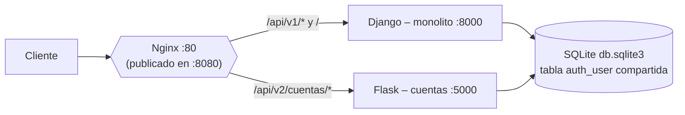

# PodiumFit

Sistema web para la gestión de reservas de un centro deportivo: reserva de espacios (canchas, salas, etc.) y de indumentaria/equipamiento, con autenticación de usuarios y notificaciones multicanal de las operaciones realizadas.

Desarrollado con **Django** (+ **Django REST Framework**), aplicando una separación por capas inspirada en **Clean Architecture / arquitectura hexagonal ligera**, de modo que las reglas de negocio no dependan de Django ni de HTTP.

Desde el Taller 02, el sistema evoluciona hacia una **arquitectura híbrida**: el monolito Django convive con un **microservicio en Flask** (`cuentas_service`) que asumió la autenticación, todo orquestado con **Docker Compose** y **Nginx** mediante el **Patrón del Estrangulador (Strangler Pattern)**.

> 📖 La justificación completa (matriz de decisión, diagramas y separación técnica) está en la Wiki: **[Migración a Microservicios (Strangler Pattern)](https://github.com/AlessandroSoccol/PODIUMFIT/wiki)**.

## Descripción del proyecto

PodiumFit está organizado como un **monolito modular por dominio**: cada app representa un límite de negocio claro (*bounded context*) y se comunica con las demás únicamente a través de interfaces explícitas (Factories/Services), nunca importando modelos de otras apps directamente.

### Apps principales

- **`PodiumFit/`** — Proyecto raíz de Django: `settings`, `urls`, `wsgi`/`asgi`.
- **`Cuentas/`** — Autenticación y gestión de usuarios (login/logout/registro), sobre el sistema estándar de Django (`authenticate`/`login`/`logout` y el modelo `User`). Su lógica fue replicada en el microservicio `cuentas_service` (ver más abajo); la app Django sigue activa mientras dura la transición.
- **`Reservas/`** — Núcleo del negocio: reserva de espacios deportivos y de indumentaria.
  - `domain/` — Reglas de negocio puras (sin Django ni HTTP):
    - `reglas.py` — Políticas centralizadas (duración máxima por espacio, límites de cantidad por tipo de indumentaria, regla de bloqueo global de reservas de espacio, etc.).
    - `builders.py` — Construcción paso a paso y validada de `ReservaEspacio` / `ReservaIndumentaria` (patrón *Builder*).
  - `infra/factories.py` — Adaptadores a infraestructura externa.
  - `models.py`, `views.py`, `services.py`, `serializers.py`, `factories.py`.
- **`Notificaciones/`** — Envío y persistencia de notificaciones a los usuarios.
- **`cuentas_service/`** — **Microservicio en Flask** que expone registro, login, logout y perfil mediante una API REST (JSON). Es el módulo "estrangulado" del monolito.

### Principios de diseño

- **Views delgadas**: solo orquestan HTTP ↔ Service. Reciben el request, delegan la validación al `Serializer`, piden al `Factory` el `Service` ya ensamblado y renderizan el resultado. No contienen lógica de negocio.
- **Services (casos de uso)**: orquestan Builder, modelo y notificador; son reutilizables desde una vista HTML, una futura API o una tarea programada.
- **Domain**: reglas de negocio puras y testeables de forma aislada.
- **Serializers (DRF)**: desacoplan la forma de los datos de entrada/salida tanto del modelo como del HTML.
- **Factories**: ensamblan dependencias externas (por ejemplo, qué `Notificador` usar según la variable de entorno `NOTIFICADOR_MODE`), evitando que vistas y servicios instancien directamente sus dependencias.

### Flujo destacado: reserva de un espacio deportivo

Es el flujo más complejo del sistema:

1. **Validación en dos niveles**: el `Serializer` valida forma/tipo de datos (HTTP) y `domain/reglas.py` valida las reglas de negocio (duración máxima, bloqueo global).
2. **Bloqueo global**: mientras exista cualquier espacio reservado y vigente para un usuario, no puede reservar otro distinto (regla transversal, no un simple chequeo de disponibilidad puntual).
3. **Liberación automática**: antes de renderizar el formulario, `ReservaEspacioService.liberar_vencidas()` libera las reservas cuyo `fin <= ahora`, sin intervención del usuario.
4. **Notificación multicanal**: `NotificadorCompuesto` reenvía el mensaje a todas sus estrategias (web + email/consola) — patrón *Composite/Strategy* — sin que `ReservaEspacioService` conozca cuántos ni cuáles canales existen.

## Arquitectura híbrida: Strangler Pattern

### Módulo estrangulado: `Cuentas`

Se evaluaron `Cuentas`, `Notificaciones` y `Reservas` con una matriz de decisión ponderada (frecuencia de cambio, consumo de recursos y acoplamiento a la base de datos). El módulo con el menor total es el candidato más seguro para extraer:

| Criterio | Peso | Cuentas | Notificaciones | Reservas |
|---|:---:|:---:|:---:|:---:|
| Frecuencia de cambio | 4 | 2 → 8 | 4 → 16 | 8 → 32 |
| Consumo de recursos | 2 | 2 → 4 | 3 → 6 | 7 → 14 |
| Acoplamiento a la base de datos | 3 | 4 → 12 | 7 → 21 | 9 → 27 |
| **TOTAL** | | **24** | **43** | **73** |
| **Decisión** | | **Flask** | Django | Django |

*(Cada celda: puntaje → puntaje × peso.)*

### Topología



### Ruteo de tráfico (Nginx)

| Ruta | Destino |
|---|---|
| `/api/v2/cuentas/` | Microservicio Flask (`cuentas:5000`) |
| `/api/v1/` | Monolito Django (`django:8000`) |
| `/` (resto) | Monolito Django (`django:8000`) |

El `proxy_pass` hacia Flask termina en `/`, por lo que Nginx elimina el prefijo `/api/v2/cuentas/` antes de reenviar la petición. Así, Flask define rutas simples (`/login`, `/registro`, `/perfil`).

### Microservicio de Cuentas (Flask)

Replica las mismas capas que tenía la app Django original (detalle en [`cuentas_service/README.md`](cuentas_service/README.md)):

| Capa | Archivo | Responsabilidad |
|---|---|---|
| Rutas/HTTP | `app.py` | Orquesta: valida entrada, delega, serializa a JSON |
| Validación | `validators.py` | Correo institucional, contraseña, coincidencia |
| Negocio | `service.py` | `AutenticacionService` + emisión/validación de JWT |
| Datos | `repository.py` | Acceso a la tabla `auth_user` |
| Seguridad | `security.py` | Hashing PBKDF2-SHA256 compatible con Django |
| Errores | `errors.py` | Errores de dominio → respuestas JSON |
| Config | `config.py` | Variables de entorno |

**API** (publicada en `/api/v2/cuentas/`):

| Método | Ruta | Descripción | Códigos |
|---|---|---|---|
| `GET` | `/health` | Healthcheck | 200 |
| `POST` | `/registro` | Crea cuenta; devuelve usuario + token | 201, 400, 409 |
| `POST` | `/login` | Autentica; devuelve usuario + token | 200, 400, 401 |
| `POST` | `/logout` | Stateless; el cliente descarta el token | 200 |
| `GET` | `/perfil` | Datos del usuario (`Authorization: Bearer <token>`) | 200, 401 |

**Formato de error** (400/401/404/405/409/500):

```json
{ "errores": { "email": ["Debes usar un correo institucional que termine en @eafit.edu.co."] } }
```

**Compatibilidad con el monolito:** ambos servicios comparten la tabla `auth_user` y el mismo hashing PBKDF2-SHA256 (1.500.000 iteraciones, el valor por defecto de Django 6.1), por lo que una cuenta creada en uno puede iniciar sesión en el otro.

### Preparado para evolucionar

Nginx actúa hoy como puerta de entrada única (*gateway* ligero): ni Django ni Flask se exponen directamente al exterior. Para estrangular otro módulo basta con crear su servicio, añadirlo al `docker-compose.yml` y agregar un `location` en `nginx.conf`.

Aspectos conocidos de la transición (detallados en la Wiki): la base de datos SQLite es compartida entre ambos servicios, y conviven la sesión de Django (vistas HTML) con el JWT del microservicio.

## Tecnologías

- Python 3.12
- Django 6.1
- Django REST Framework 3.18.0
- asgiref 3.12.1
- sqlparse 0.6.0
- tzdata 2026.3
- **Flask 3.0.3** (microservicio de cuentas)
- **PyJWT 2.9.0**
- **gunicorn 23.0.0** (servidor WSGI en ambos servicios)
- **Docker / Docker Compose**
- **Nginx 1.27** (reverse proxy)

## Instalación y ejecución

### Opción A: con Docker (recomendada)

Levanta Django, el microservicio Flask y Nginx con un solo comando.

#### 1. Clonar el repositorio

```bash
git clone https://github.com/AlessandroSoccol/PODIUMFIT.git
cd PODIUMFIT
```

#### 2. (Opcional) Configurar variables de entorno

Compose usa valores por defecto si no se definen. Puedes sobrescribirlos en un archivo `.env` en la raíz:

```bash
NOTIFICADOR_MODE=MOCK                                  # Notificador que ensambla la Factory
CUENTAS_SECRET_KEY=cambia-esta-clave-en-produccion     # Clave para firmar los JWT (cámbiala en producción)
```

#### 3. Construir y levantar los servicios

```bash
docker compose up --build
```

Servicios que se levantan:

| Servicio | Descripción | Puerto |
|---|---|---|
| `django` | Monolito Django (gunicorn) | 8000 (interno) |
| `cuentas` | Microservicio Flask (gunicorn) | 5000 (interno) |
| `nginx` | Reverse proxy, único punto de entrada | **8080** → 80 |

#### 4. Probar

| URL | Destino |
|---|---|
| `http://localhost:8080/` | Django (web, admin, reservas) |
| `http://localhost:8080/api/v1/` | Django |
| `http://localhost:8080/api/v2/cuentas/health` | Flask (healthcheck) |

```bash
# Registro
curl -X POST http://localhost:8080/api/v2/cuentas/registro \
  -H "Content-Type: application/json" \
  -d '{"email":"juan@eafit.edu.co","password":"ClaveSegura123","password2":"ClaveSegura123","nombre":"Juan"}'

# Login
curl -X POST http://localhost:8080/api/v2/cuentas/login \
  -H "Content-Type: application/json" \
  -d '{"email":"juan@eafit.edu.co","password":"ClaveSegura123"}'

# Perfil
curl http://localhost:8080/api/v2/cuentas/perfil \
  -H "Authorization: Bearer <TOKEN>"
```

### Opción B: solo el monolito, en local

> Los comandos abajo siguen el flujo estándar de un proyecto Django. Ajusta nombres de archivos/entorno si tu configuración real difiere.

#### 1. Crear y activar un entorno virtual

```bash
python -m venv venv

# Linux / macOS
source venv/bin/activate

# Windows
venv\Scripts\activate
```

#### 2. Instalar dependencias

```bash
pip install -r requirements.txt
```

#### 3. Configurar variables de entorno

Crea un archivo `.env` (o exporta las variables en tu sistema) con al menos:

```bash
NOTIFICADOR_MODE=consola   # controla qué Notificador ensambla la Factory (p. ej. consola/email/mock)
```

Revisa `PodiumFit/settings.py` por si hay otras variables requeridas (clave secreta, base de datos, etc.).

#### 4. Aplicar migraciones

```bash
python manage.py migrate
```

#### 5. (Opcional) Crear un superusuario

```bash
python manage.py createsuperuser
```

#### 6. Levantar el servidor de desarrollo

```bash
python manage.py runserver
```

La aplicación quedará disponible en `http://127.0.0.1:8000/`. En este modo no corre el microservicio de cuentas ni Nginx.

## Variables de entorno

| Variable | Servicio | Default | Descripción |
|---|---|---|---|
| `NOTIFICADOR_MODE` | Django | `MOCK` (en Docker) | Notificador que ensambla la Factory |
| `DJANGO_DB_PATH` | Django | `/data/db.sqlite3` (en Docker) | Ruta a la BD SQLite |
| `CUENTAS_DB_PATH` | Flask | `/data/db.sqlite3` | Ruta a la BD SQLite compartida |
| `CUENTAS_SECRET_KEY` | Flask | (placeholder) | Clave para firmar los JWT |
| `CUENTAS_JWT_EXPIRES_MIN` | Flask | `60` | Minutos de vida del token |
| `CUENTAS_DOMINIO` | Flask | `@eafit.edu.co` | Dominio institucional permitido |
| `CUENTAS_PBKDF2_ITERATIONS` | Flask | `1500000` | Debe coincidir con las iteraciones de Django |

## Estructura del proyecto

```
PODIUMFIT/
├── PodiumFit/            # Proyecto raíz: settings, urls, wsgi/asgi
├── Cuentas/              # App Django: autenticación y gestión de usuarios (legacy)
├── Reservas/             # App: núcleo del negocio (espacios e indumentaria)
│   ├── domain/           # Reglas de negocio puras
│   │   ├── reglas.py
│   │   └── builders.py
│   ├── infra/            # Adaptadores a infraestructura externa
│   │   └── factories.py
│   ├── models.py
│   ├── views.py
│   ├── services.py
│   ├── serializers.py
│   └── factories.py
├── Notificaciones/       # App: envío y persistencia de notificaciones
├── cuentas_service/      # Microservicio Flask (módulo estrangulado)
│   ├── app.py            # Rutas / HTTP
│   ├── validators.py     # Validación de entrada
│   ├── service.py        # Lógica de negocio + JWT
│   ├── repository.py     # Acceso a auth_user
│   ├── security.py       # Hashing PBKDF2
│   ├── errors.py         # Errores → JSON
│   ├── config.py         # Variables de entorno
│   ├── requirements.txt
│   ├── Dockerfile        # Imagen independiente de Flask
│   └── README.md
├── Dockerfile            # Imagen del monolito Django
├── docker-compose.yml    # Django + Flask + Nginx
├── nginx.conf            # Ruteo de tráfico (/api/v1, /api/v2/cuentas)
└── requirements.txt
```
